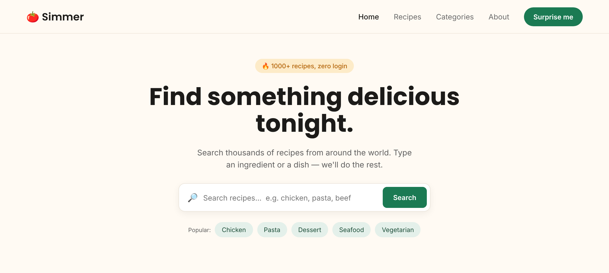

<div align="center">
# 🍅 Simmer: Recipe Finder
**A one-page recipe finder built with plain HTML, CSS and JavaScript.**


</div>
---
## 📖 About
Simmer is the front page of a recipe finder website, built from the **"Simmer - Recipe Finder" Figma design**. It uses no frameworks or libraries: just HTML for the content, CSS for the design and JavaScript for the search.
Built by **Hasnaad Din** as part of the **ITC Full-Stack training** (November 2026).
---
## ✨ Features
- 
🎨 **Matches the Figma design:** top bar, big heading, search box and "Popular" category chips
- 
🔎 **Google recipe search:** type an ingredient or dish and get recipe results in a new tab
- 
⌨️ **Works with the mouse or keyboard:** click **Search** or just press **Enter**
- 
⚠️ **Empty search check:** asks you to type something if the box is empty
- 
🗂️ **Clean structure:** content, design and behaviour each live in their own file
---
## 🚀 How to run it
No installation needed.
1. 
Download or clone this branch
2. 
Open the project folder
3. 
Double-click **`index.html`** to open it in your browser
**Try it:** type `chicken` and press **Enter**. Google opens with results for **"chicken recipe"**.
---
## 📁 Project structure
```
📦 Simmer
 
┣ 📄 index.html      → page content (what is on the page)
 
┣ 🎨 style.css       → colours, fonts and layout (how it looks)
 
┣ ⚙️ script.js       → search behaviour (what it does)
 
┣ 🖼️ screenshot.png  → picture used in this README
 
┗ 📝 README.md       → this file
```
---
## ⚙️ How the JavaScript works
| Step | Code | What it does |
|:---:|------|--------------|
| 1 | `document.querySelector(".search")` | Finds the search form, using the same class name as the CSS |
| 2 | `addEventListener("submit", ...)` | Runs the code when Search is clicked or Enter is pressed |
| 3 | `event.preventDefault()` | Stops the page from reloading |
| 4 | `searchInput.value.trim()` | Reads what the user typed and removes extra spaces |
| 5 | `encodeURIComponent(text + " recipe")` | Adds "recipe" and makes the text safe for a web address |
| 6 | `window.open(url, "_blank")` | Opens the Google results in a new tab |
---
## 🛠️ Built with
- 
**HTML5:** page structure
- 
**CSS3:** Flexbox layout, rounded "pill" buttons, soft shadows
- 
**JavaScript:** no libraries
- 
**Google Fonts:** Poppins (headings) and Inter (body text)
---
## 🔮 Next steps
- 
[ ] Make the "Popular" chips clickable so they run a search
- 
[ ] Make the **Surprise me** button search for a random dish
- 
[ ] Show real recipe cards on the page using the free [TheMealDB](https://www.themealdb.com/api.php) API
---
<div align="center">
Made with 🍅 by **Hasnaad Din**
</div>
